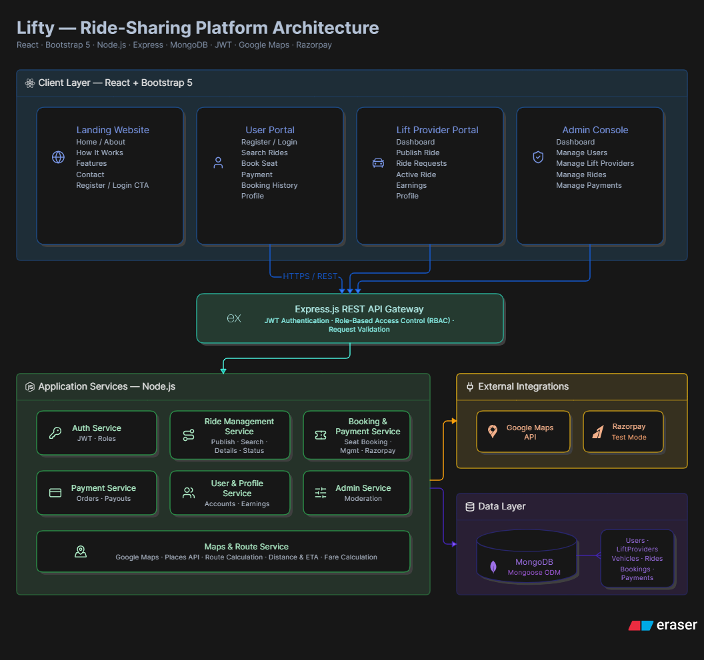

# 🚗 Lifty – Ride Sharing Platform

A portfolio-quality MERN Stack Ride Sharing Platform where people who are already travelling can publish rides, and other users can book available seats.

---

## 🏗️ System Architecture

---

## 🚀 Tech Stack

### Frontend
- React (Vite)
- Bootstrap 5
- Bootstrap Icons
- React Router

### Backend
- Node.js
- Express.js

### Database
- MongoDB
- Mongoose

### Authentication
- JWT
- bcrypt

### APIs
- Google Maps API
- Google Places API
- Razorpay (Test Mode)